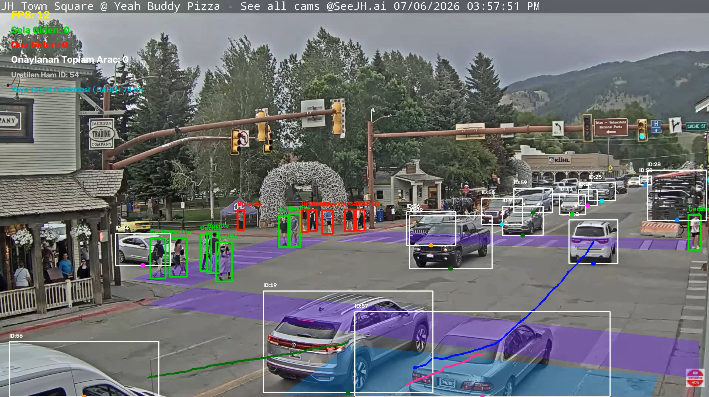

# Intersection Traffic Analysis

A computer vision project from my internship at Visea İnovatif.
I built a prototype that analyzes intersection video to monitor
pedestrian crosswalk zones, track vehicles, and count their movements.

## Features

- **Crosswalk monitoring:** Pedestrians inside marked crosswalk zones
  are shown with green boxes. Pedestrians outside are shown in red.
- **Vehicle tracking:** Vehicles are labeled with tracking IDs, and
  their paths are drawn across successive video frames.
- **Vehicle counting:** The overlay shows separate counts for
  left-turning and straight-through vehicles, plus the total count.

## Project files

The Python scripts cover data collection, selection of regions of
interest (ROIs), and video analysis. Running the video analysis
requires a video source and compatible model files.
## Demo

